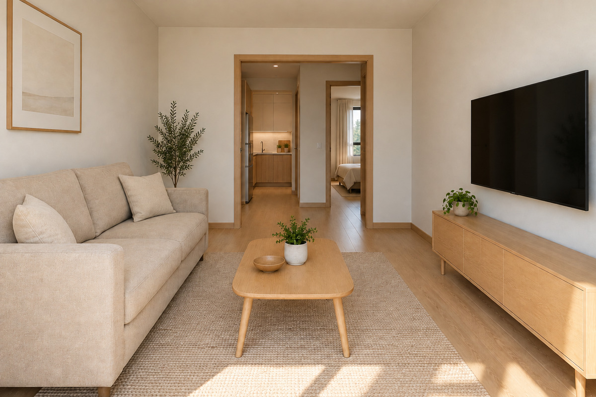
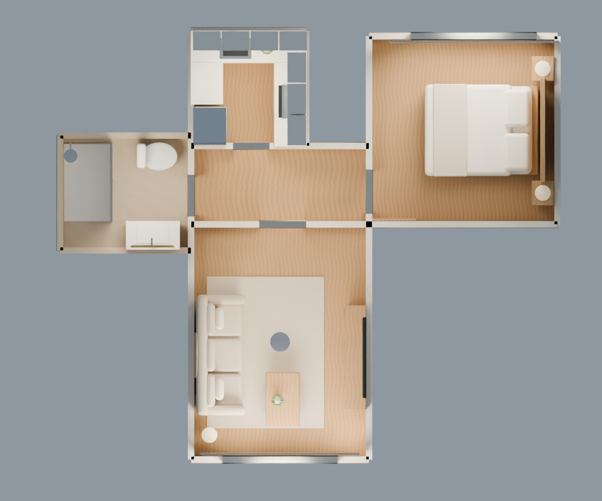
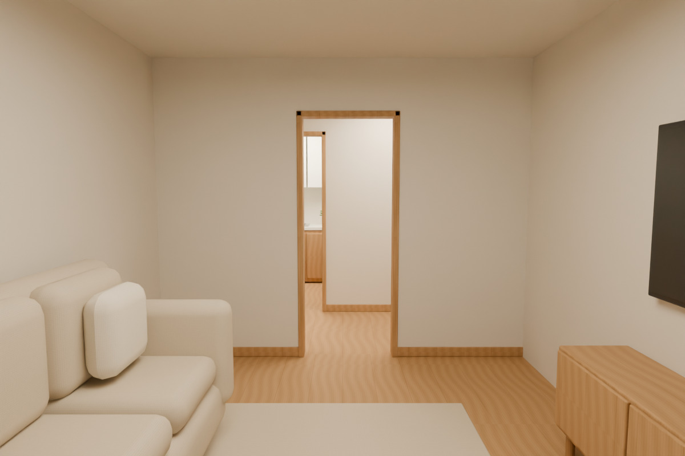

# Room Photo to 3D · 室内照片到 Blender

这套工具把室内实拍、视频关键帧或已确认的布局整理成可追溯的建模输入，再交付可编辑的 Blender 工程和各视角渲染。适合民宿、样板房和小型室内空间复原。Codex 负责读图、整理证据和建模；Python 与 Blender 脚本用于校验数据、创建基础外壳、同步已有家具模板和渲染。

| 合成参考图 | 候选户型 | Blender 室内渲染 |
| --- | --- | --- |
|  |  |  |

三张图来自同一合成房源示例。户型包含根据照片补全的区域，不能用于测绘。[查看示例说明](docs/example.md)

## 快速开始

克隆仓库并在 Codex 中打开仓库根目录。根目录的 [AGENTS.md](AGENTS.md) 会指引 Codex 按任务选择 skill。把自己的图片或视频关键帧放到被 Git 忽略的 `input/`：

> 使用 `$room-reconstruction-pipeline` 分析 `input/living-room/` 的照片，列出墙、门窗和稳定大件，记录每张图的相对位置以及材质证据。先给我候选户型、尺寸依据和待确认项，确认后生成可编辑的 Blender 工程和室内预览。

把真实房源的下载清单、报告和渲染留在 `work/` 或 `output/`。图片下载清单会记录原始 URL，可能包含临时签名。提交示例前请检查链接、图片元数据和模型内打包的引用素材。忽略规则只影响未跟踪的文件。

要单独委派时，可以在提示里指定「请让 `room_reconstruction` Agent 处理这个房间」，其职责在 [项目 Agent 配置](.codex/agents/room-reconstruction.toml) 中定义。各 skill 的 `agents/openai.yaml` 用于展示名称和缺省调用提示。两类文件的用途分别见 [Codex Agent 文档](https://learn.chatgpt.com/docs/agent-configuration/subagents)和 [Skills 文档](https://learn.chatgpt.com/docs/build-skills)。

## 工作流程

| 阶段 | Skill | 主要输出 |
| --- | --- | --- |
| 分析照片 | [room-photo-inventory](.agents/skills/room-photo-inventory/SKILL.md) | 编号和跨图去重后的家具清单、逐图观察、间距、颜色纹理与候选户型 |
| 搭建场景 | [room-inventory-to-blender](.agents/skills/room-inventory-to-blender/SKILL.md) | `scene-spec.json`、有真实门窗洞口的完整墙地顶、可编辑家具和中央相机 |
| 应用确认并复验 | [room-reconstruction-pipeline](.agents/skills/room-reconstruction-pipeline/SKILL.md) | 应用尺寸和净距、同步详细模板、验收朝向和承托、输出渲染 |

可选输入包括实测房间尺寸、户型草图、已配准深度帧以及现有 `.blend`。每个关键判断应能追溯到图片、量尺或用户确认。把未知和补全依据写入配置，例如有家具的照片没有拍到门口，就先把门位留作候选。

## 命令行示例

需要 Python 3 和 Blender。以下命令在 macOS 的 Blender 5.2 与 Python 3 上验证。将 `blender` 指向系统里的可执行文件即可；例如 macOS 的 `/Applications/Blender.app/Contents/MacOS/Blender`。照片下载和深度融合需要额外依赖，可运行 `python3 -m pip install -r requirements.txt` 安装。建模示例无需下载素材或安装额外 Python 包。

从仓库根目录运行以下命令。示例创建桌椅测试场景，演示把家具模板放到候选布局中、重开文件验收，并渲染一张小图。每次运行请选择新的 `demo_dir`。

```sh
pipeline=.agents/skills/room-reconstruction-pipeline/scripts
demo_dir="$PWD/work/furniture-demo"

blender -b --factory-startup --python-exit-code 1 \
  --python "$pipeline/create_test_room.py" -- "$demo_dir"
blender -b "$demo_dir/source.blend" --python-exit-code 1 \
  --python "$pipeline/blender_pipeline.py" -- sync \
  --profile "$demo_dir/profile.json" --output "$demo_dir/room.blend" --negative-probe
blender -b "$demo_dir/room.blend" --python-exit-code 1 \
  --python "$pipeline/blender_pipeline.py" -- qa \
  --profile "$demo_dir/profile.json" --output "$demo_dir/qa.json" --negative-probe
blender -b "$demo_dir/room.blend" --python-exit-code 1 \
  --python "$pipeline/blender_pipeline.py" -- render \
  --profile "$demo_dir/profile.json" --output "$demo_dir/renders"
```

查看 `work/furniture-demo/room.blend`、`qa.json` 和 `renders/test.png`。`--negative-probe` 会短暂反转一把椅子，验证朝向检查能抓到错误，再恢复正确状态。这是独立的脚本样例，上方的全屋配图说明的是另一组合成照片的建模过程。

要从一个空房开始，可用矩形外壳示例生成六面、中央相机和同位置的四向机位：

```sh
shell_skill=.agents/skills/room-inventory-to-blender
mkdir -p work
blender -b --factory-startup --python-exit-code 1 \
  --python "$shell_skill/scripts/create_room_shell.py" -- \
  --config "$shell_skill/assets/scene-spec.example.json" --output work/shell.blend
blender -b work/shell.blend --python-exit-code 1 \
  --python "$shell_skill/scripts/validate_scene.py" -- \
  --config "$shell_skill/assets/scene-spec.example.json" --output work/shell-qa.json
```

## 脚本和数据约定

- `room-photo-inventory/scripts/` 提供参考图下载、清单、家具间距和材质数据的检查。字段见[照片数据约定](.agents/skills/room-photo-inventory/references/data-contract.md)和[材质说明](.agents/skills/room-photo-inventory/references/color-texture-analysis.md)。
- `room-inventory-to-blender/scripts/` 提供矩形外壳和 Blender 场景验收。实际门窗、异形轮廓和家具根据各自证据建模，见[场景约定](.agents/skills/room-inventory-to-blender/references/input-and-scene-contract.md)。
- `room-reconstruction-pipeline/scripts/` 提供已确认布局编辑、静态模板同步、实际网格 QA、渲染以及可选深度融合。见[布局输入](.agents/skills/room-reconstruction-pipeline/references/contracts.md)、[Blender 配置](.agents/skills/room-reconstruction-pipeline/references/blender.md)和[深度导出要求](.agents/skills/room-reconstruction-pipeline/references/scan.md)。

## 验证与排查

```sh
pipeline=.agents/skills/room-reconstruction-pipeline/scripts
python3 "$pipeline/test_layout_constraints.py"
mkdir -p work
python3 "$pipeline/test_blender_pipeline.py" --blender "$(command -v blender)" \
  --result work/blender-regression.json
```

- 布局编辑遇到哈希不匹配时，重新核对用户标注与当前布局版本。模板同步遇到零匹配或朝向校验失败时，检查对象名、模板原点及实际网格前向。
- 渲染输出目录须为空或尚未存在。桌椅和承托检查只覆盖配置声明的对象，结果 JSON 会列出检查结果与缺项。

## 常见问题

**照片能直接得到完整尺寸和 3D 吗？** 需要 Codex 或建模人员解析证据、确认布局并选择建模方式。照片可以给出相对位置和外观线索；精确尺寸需要实测或有尺度依据的扫描。

**程序生成的结果为什么和照片有差别？** 遮挡、相机畸变、曝光和照明都会影响判断。先对齐机位和几何，再对照地面、柜体、织物的色相、纹理方向和反光。脚本检验数据或几何约束，视觉验收还需要逐图对照。

## 许可证

仓库代码、Skill、Agent 配置和配套文字文档采用 [MIT 许可证](LICENSE)。`docs/images/` 内的合成示例图仅用于项目展示，不在本许可证授权范围内。图片来源见[示例说明](docs/example.md)。
