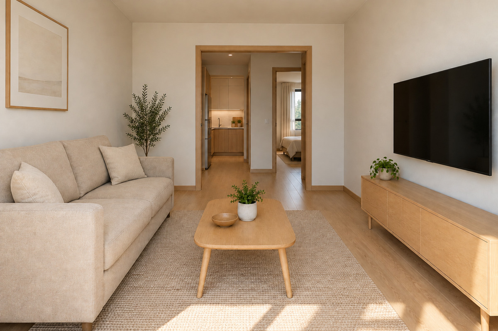
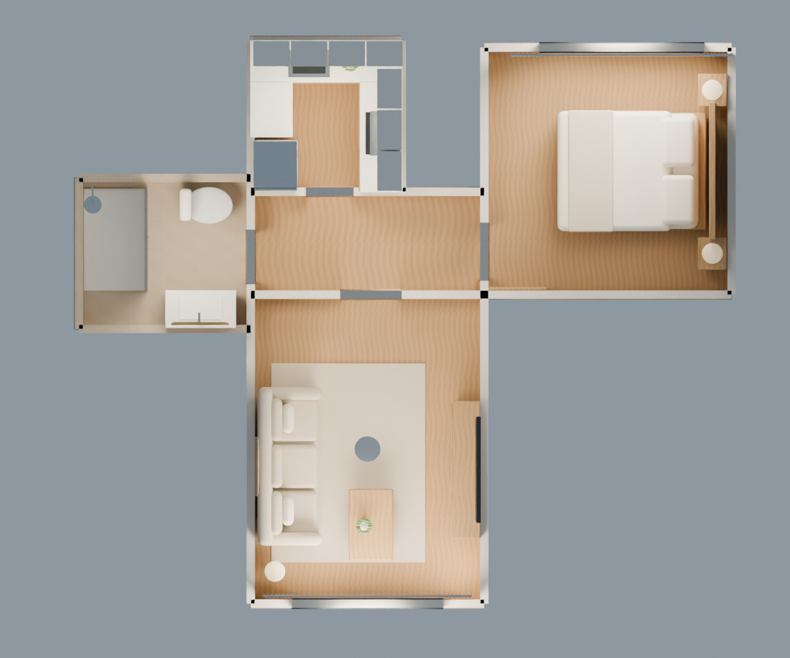
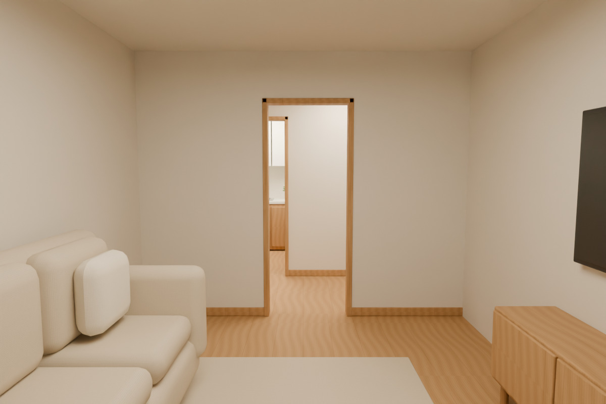

# 合成示例 · 原木奶油公寓

用同一套合成参考图演示如何提取空间线索、补齐候选户型，再在 Blender 中制作可编辑几何。三张图对应流程中的三个阶段。

## 从参考图记录观察

从客厅朝走廊看，沙发在画面左侧，电视与低柜在右侧，茶几在中间，两者之间留有通向走廊的通道。另一个补充视角拍到客厅开口与卫浴入口同框，为走廊的连接关系提供证据。反向视角会交换画面左右，写入布局前需要借助沙发、电视和门洞识别同一面墙。

## 在候选户型中标注假设

候选布局保留客厅通向短走廊的开口，走廊连接厨房、卧室和卫浴。客厅保留门套与洞口，按示例约束取消门扇。墙厚、门洞宽度、家具尺寸、具体坐标和卧室朝向都是建模估值，补齐时应与图中直接可见的事实分开记录。

## 对照 Blender 渲染

渲染保留了沙发与电视相对摆放、客厅没有门扇、走廊位于前方等关系。参考图与模型的门洞比例和局部材质仍有差异，适合用来评审布局与进一步调整相机、几何和材质。

参考图来自本项目用图像生成工具制作的合成测试集，原文件名为 `02-living-reverse.png`。俯视图和客厅图均为该测试案例的 Blender 渲染，原文件名分别为 `floorplan-candidate.png` 和 `reference-02.png`。仓库内为压缩预览图。该案例没有标定相机或实测尺寸，不能据此评估几何还原精度。
